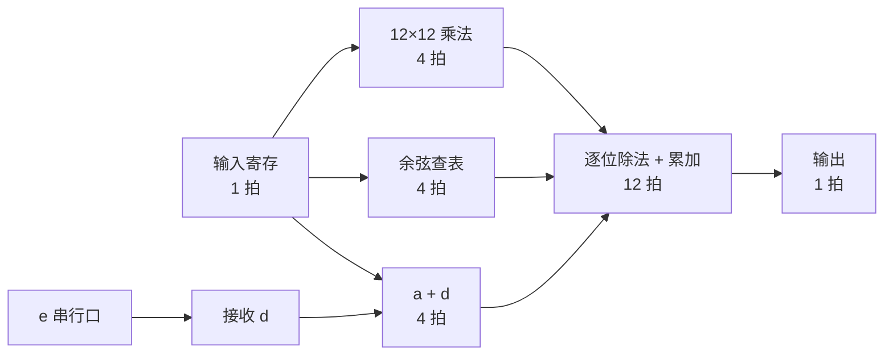

<div align="center">

# function_gen

**一道题，从一行公式做到一张版图**

数字集成电路全流程练习 · 完整版


</div>

---

这是 `function_gen` 的完整版：一份从 RTL 仿真一路做到后仿、每一步都跑通的参考实现。

如果你还没做过这道题，建议先去 [`main`](../../tree/main) 分支自己试一遍。这里的每个"解法"单独看都只有几行脚本，但知道为什么需要它，比知道它怎么写重要得多。

$$
y = \frac{a \cdot b \cdot \cos\left(2\pi c / 4096\right)}{(a + d) \cdot 4096}
$$

<div align="center">

200 MHz · 误差 ±4 LSB · 输入只有 `a` `b` `c` `e` `clk`

</div>

> 题目、环境要求和流程说明见 [**docs/function_gen项目说明.pdf**](docs/function_gen项目说明.pdf)。

## 结果

| | |
| --- | --- |
| **功能** | 102 376 组向量全部通过，最大误差 1.891 LSB；RTL、综合后、布局布线后三次仿真结果完全一致 |
| **形式验证** | 综合后、布局布线后各 1264 个比较点，全部等价 |
| **时序签核** | 三个工艺角无违例；最慢角建立余量 **+0.020 ns**，最快角保持余量 **+0.047 ns** |
| **DRC** | 只剩 6 条金属最小密度规则 |
| **天线 / LVS** | 0 违例 / `CORRECT` |
| **规模** | 约 584 × 581 µm，利用率 40%，标准单元面积约 127 000 µm²，触发器 1251 个 |

工具：VCS / Verdi、Design Compiler、Formality、IC Compiler II、PrimeTime（X-2025.06），Calibre 2025。工艺库是一套 0.18 µm、1.8 V、7 轨、6 层金属的标准单元库。

### 这组数字没告诉你的

漂亮的结果表很容易让人误会，所以把该交代的交代清楚：

- **建立时间余量只有 20 皮秒。** 这是扣掉 1 ns 时钟不确定度之后的值。设计满足 200 MHz，但几乎没有富余。
- **输入输出延迟各取了半个周期**，没有按"输入紧贴时钟沿变化"的最严格情况来约束。
- **寄生参数来自布局布线工具的提取**，不是签核级提取工具的结果，连线寄生也只有典型工艺一种模型。
- **金属密度那 6 条 DRC 没有修。** 模块级设计没有做金属填充，实际流片时由顶层统一处理。
- **18 拍不是下限。** 乘法和除法的拍数与每拍的逻辑深度之间还有调整空间。

## 设计



乘法、余弦查表、除数准备三条通路并行，各占 4 拍；之后是 12 级除法，每一级出一位商，同时把这一位对应权重的余弦值累加进结果。除法和"乘以余弦"合在同一段流水线里做，省掉了一个独立的乘法器和它的拍数。

| 文件 | 作用 |
| --- | --- |
| `function_gen.v` | 顶层：输入寄存、a + d、各通路的连线和对齐 |
| `d_rx.v` | 从 `e` 串行接收 d。空闲为 0，1 位起始位后跟 12 位数据，高位在前。没有复位端口，靠一个会自己清空的移位令牌进入确定状态 |
| `mul12.v` | 12 × 12 无符号乘法，部分积分 4 拍压缩 |
| `cos_lut.v`、`cos_rom.vh` | 象限折叠后只存 1/4 周期共 1024 项，输出幅值和符号。表由 `gen_cos_rom.py` 生成 |
| `div_acc.v`、`div_stage.v`、`acc_step.v` | 12 级恢复余数除法；累加用进位保留形式，最后一拍才做进位传播 |
| `tb/tb_function_gen.v` | testbench：实数参考模型，边界值加随机向量 |

## 一路上遇到的问题

流程图上的每个箭头，实际做的时候都卡过。按出现的顺序记在这里：

<details>
<summary><b>综合：一百多条路径各差几十皮秒</b></summary>

<br>

第一次综合，最差 slack −0.04 ns，违例路径 115 条。综合工具默认只盯着最差的那一条优化，而这个设计是 12 级结构相同的除法，路径长度几乎一样。给它一个临界范围，让接近最差的路径一起优化，就收敛了。

→ `1_dc/tcl/dc.tcl`

</details>

<details>
<summary><b>填充单元：库里找不到</b></summary>

<br>

填充单元和阱接触单元只有版图，没有时序信息，常规方式建参考库时会被整个丢掉。解决办法是另建一个只含物理信息的库，挂在主库后面。

→ `0_lib/tcl/ndm_phys.tcl`、`4_icc2/scripts/00_init.tcl`

</details>

<details>
<summary><b>DRC：几万处闩锁违例</b></summary>

<br>

几乎每个单元都报。去读规则原文才明白：这套库的单元本身不带阱接触，要在版图里按固定间隔插专门的接触单元，而且必须在布局之前放好。最初的脚本是按"单元自带接触"写的，错了。

→ `4_icc2/scripts/01_floorplan.tcl`

</details>

<details>
<summary><b>天线：两个工具各说各话</b></summary>

<br>

工艺文件里没有天线规则，布局布线工具压根没检查，Calibre 一查就是十几处。把规则文件里的比例换算成工具的设置之后，内部线网都修好了，剩下的违例全在芯片左边缘，是输入端口的线。

原因是输入端口的线网在芯片内部没有驱动器，也就没有能泄放电荷的扩散区，允许的比例比内部线网严得多。给每个输入端口接一个保护二极管即可。

→ `4_icc2/icc2_files/antenna.tcl.example`、`4_icc2/scripts/03_pin.tcl`、`06_route.tcl`

</details>

<details>
<summary><b>布线后：建立和保持各剩几十皮秒</b></summary>

<br>

再跑一轮布线后优化也不动。做法是临时把不确定度加大一点，让工具多优化一些，再改回题目要求的值，最后不加余量地平衡一轮。

→ `4_icc2/scripts/06_route.tcl`

</details>

<details>
<summary><b>LVS：从 NOT COMPARED 到 INCORRECT 到 CORRECT</b></summary>

<br>

这一步花的时间最多，前后三个问题：

1. **根本没比对。** 网表里例化了填充和阱接触单元，而单元的 SPICE 库里没有它们的子电路。
2. **补了空子电路，变成一万多个器件对不上。** 这些单元里没有晶体管，版图一侧什么都提取不出来；网表一侧应该把它们直接删掉，而不是补一个空壳。
3. **还剩几十个器件对不上，全集中在乘法器里。** 线索藏在报告末尾那串"找不到对应"的线网名里：综合工具在同一个模块里同时生成了 `N12` 和 `n12`。Verilog 区分大小写，SPICE 默认不区分，两条线在网表一侧被当成了同一条。

第三个问题和电路本身没有任何关系，一句配置就解决了，却是最难找的一个。

→ `5_LVS/run.sh`

</details>

<details>
<summary><b>时序签核：两个工具差了半纳秒</b></summary>

<br>

布局布线工具报告没有违例，PrimeTime 却在端口路径上报了半纳秒的违例。内部寄存器之间的路径两边完全一致。

原因在约束：最初的写法把输入延迟的最小值单独设成了 0，意思是输入数据可能在时钟沿到达引脚的同一瞬间变化。时钟树做完之后，布局布线工具会自动给端口的参考时钟补一段延迟，PrimeTime 不会，于是两边对端口路径的结论互相矛盾。改成输入输出延迟各取半个周期之后，两个工具的结论对上了。

这也是结果表下面那条"没有按最严格情况约束"的由来。

→ `1_dc/tcl/top.sdc`

</details>

<details>
<summary><b>还有一个差点漏掉的</b></summary>

<br>

整理寄生参数的脚本按文件名挑文件，结果三个工艺角用的都是同一份、而且是低温的那份。最慢角因此显得比实际乐观。三份文件大小一模一样，才露了馅。

→ `7_StarRC/run.sh`

</details>

## 复现

需要自备工具、标准单元库和 PDK，**仓库不提供**。

```bash
# 1. 在 flow.cfg 里填库的路径; 文件名或单元名不同时改 common/env.sh

# 2. 从模板生成三个含设计规则数值的本地文件, 对照自己的 PDK 填写
cp 4_icc2/icc2_files/gdsout_text.map.example  4_icc2/icc2_files/gdsout_text.map
cp 4_icc2/icc2_files/text_layers.tcl.example  4_icc2/icc2_files/text_layers.tcl
cp 4_icc2/icc2_files/antenna.tcl.example      4_icc2/icc2_files/antenna.tcl

# 3. 检查环境
./check_env.sh
```

然后按目录编号依次执行：

| 目录 | 命令 | 目录 | 命令 |
| --- | --- | --- | --- |
| `0_lib` | `./run.sh` | `6_formality_postlayout` | `./run.sh` |
| `0_simulation_pre` | `make` | `5_DRC` | `./run.sh` |
| `1_dc` | `./run.sh` | `5_LVS` | `./run.sh` |
| `2_formality_postdc` | `./run.sh` | `7_StarRC` | `./run.sh` |
| `3_simulation_postdc` | `make` | `8_pt` | `./run.sh` |
| `4_icc2` | `./run.sh all` | `9_simulation_postlayout` | `make` |

## 说明

- 仓库不含任何工艺厂或 EDA 厂商的文件，也不含由它们生成的版图、网表和报告。`.gitignore` 已经把这些排除，提交时请留意。
- 公开版把天线比例、层号这类设计规则数值挪到了不进仓库的本地文件里，其余脚本与跑通时使用的一致。
- 换工具版本或工艺库之后多半需要调整，尤其是布局布线工具的选项名、库的单元名，以及版图验证规则文件的用法。
- 题目来自一门数字集成电路设计课程的课程设计，这里是重新表述的版本。
