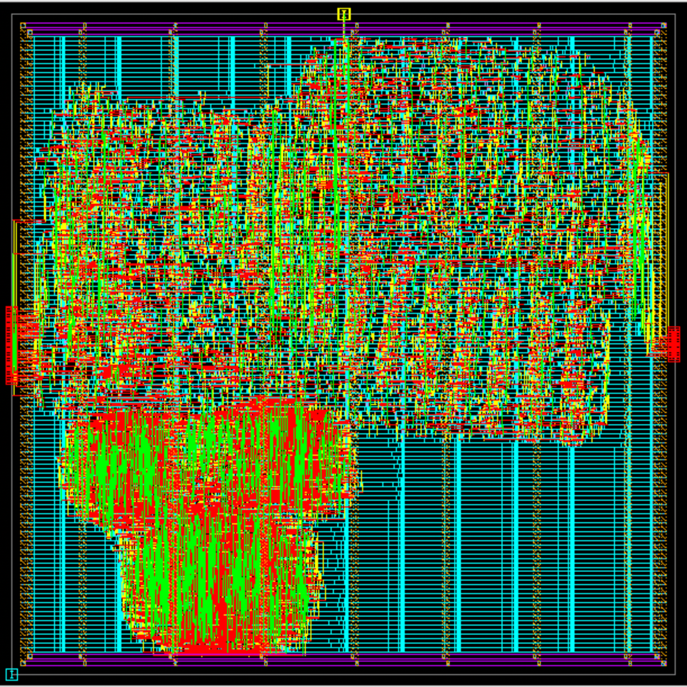
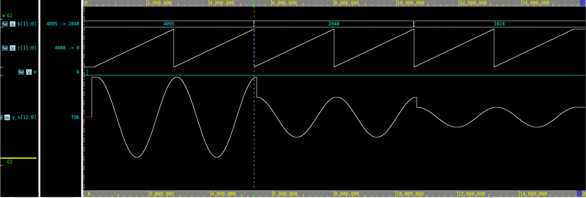
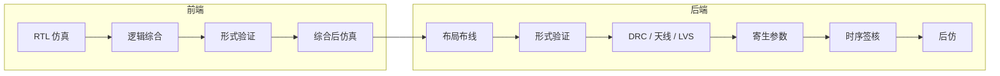

<div align="center">

# function_gen

**一道题，从一行公式做到一张版图**

数字集成电路全流程练习 · 题目版


</div>

---

课本上的数字 IC 流程是一张很干净的图：写代码、综合、布局布线、验证，一个箭头接一个箭头。真正动手做一遍才知道，箭头和箭头之间全是坑。

这个仓库就是一次完整的动手：拿一个不大的定点运算电路，从 RTL 一直做到通过 DRC / LVS 和时序签核的版图。题目只有一行公式，最后的电路也就六千来个标准单元，但它足够让你把流程里的每一环都认真过一遍。

这是**题目版**：有题目、有目录、有能跑起来的基础脚本，**没有答案**。RTL 要你自己设计，约束要你自己写，后端遇到的问题要你自己解决。

做完想对照，或者只想看完整流程长什么样，去 [`solution`](../../tree/solution) 分支。

<table>
  <tr>
    <td width="38%"></td>
    <td width="62%"></td>
  </tr>
  <tr>
    <td align="center"><sub>做到最后，你会得到这样一张版图</sub></td>
    <td align="center"><sub>以及一个真的能算出余弦的电路（图为参考设计，c 连续扫描、b 逐段减半时的输出 y）</sub></td>
  </tr>
</table>

## 题目

$$
y = \frac{a \cdot b \cdot \cos\left(2\pi c / 4096\right)}{(a + d) \cdot 4096}
$$

| | |
| --- | --- |
| **数据** | a、b、c、d 是 12 位无符号整数；y 是 13 位有符号数，真实值为 y / 4096 |
| **端口** | 输入只有 `a[11:0]`、`b[11:0]`、`c[11:0]`、`e`、`clk`，输出 `y[12:0]` |
| **精度** | 误差不超过 y 的 ±4 个最低位 |
| **时序** | 200 MHz；时钟不确定度：建立 1 ns，保持 300 ps |
| **目标** | 满足以上条件，输入到输出的延迟拍数越少越好 |

注意端口表里没有 `d`，也没有复位。d 要从 `e` 这一根线上串行送进来，怎么送由你定。类似这样没写死的地方还有几处，比如 a + d = 0 时输出什么、在哪一级舍入。它们都是题目的一部分。

> 完整的题目说明、环境要求、每一步怎么做，在 [**docs/function_gen项目说明.pdf**](docs/function_gen项目说明.pdf) 里，15 页，建议先读。

## 为什么说它不简单

5 ns 的周期，先被时钟不确定度拿走 1 ns。剩下的 4 ns 里，乘法、除法、查表哪一个都没法一拍做完，必须拆成流水线；拆得越细时序越松，延迟拍数却越多，而拍数正是要优化的目标。

到了后端，事情会变得更具体。基础脚本能把流程跑起来，但你大概会依次遇到这些：

- DRC 一口气报几万处违例，几乎每个单元都中
- 布局布线工具说天线没问题，Calibre 不同意
- 布线之后建立时间和保持时间各剩几十皮秒，怎么优化都不动
- LVS 有几十个器件对不上，而原因和电路本身毫无关系
- 两个工具对同一条路径的时序结论差了半纳秒

每一条都有明确的原因，也都是真实项目里会遇到的事。说明文档第 6 章给了现象和方向，不给答案。

## 流程



| 步骤 | 目录 | 命令 | 过关标准 |
| --- | --- | --- | --- |
| 准备 | `0_lib` | `./run.sh` | 建出 ICC2 用的参考库 |
| 1 | `0_simulation_pre` | `make` | `TEST PASSED` |
| 2 | `1_dc` | `./run.sh` | 建立时间 slack ≥ 0 |
| 3 | `2_formality_postdc` | `./run.sh` | `Verification SUCCEEDED` |
| 4 | `3_simulation_postdc` | `make` | 结果与第 1 步一致 |
| 5 | `4_icc2` | `./run.sh N` | 时序、DRC、连通性全部干净 |
| 6 | `6_formality_postlayout` | `./run.sh` | `Verification SUCCEEDED` |
| 7 | `5_DRC`、`5_LVS` | `./run.sh` | DRC 无违例或能逐条解释；LVS `CORRECT` |
| 8 | `7_StarRC` | `./run.sh` | 三个工艺角的 SPEF |
| 9 | `8_pt` | `./run.sh` | 三个工艺角无违例 |
| 10 | `9_simulation_postlayout` | `make` | `TEST PASSED` |

## 这个分支里有什么

| 有 | 没有 |
| --- | --- |
| 按流程编号的目录和基础脚本 | RTL |
| 一份验收用 testbench（拍数和串行格式要按你的设计改） | 时序约束（`1_dc/tcl/top.sdc` 是待填的模板） |
| 15 页的项目说明 | 后端各种问题的解法 |
| 开工检查脚本 `check_env.sh` | 工艺库、PDK、EDA 工具 |

## 开始

**1. 准备工具和工艺库。** 脚本基于 VCS / Verdi、Design Compiler、Formality、IC Compiler II、Calibre、PrimeTime。另需一套 0.18 µm 标准单元库和配套 PDK，**仓库不提供**，需要哪些文件见说明文档第 3 章。

**2. 改配置。** 库的路径写在 `flow.cfg`；库的文件名、单元名和默认配置不同时改 `common/env.sh`。

**3. 填两个本地文件。** 它们含有设计规则数值，不进仓库，只给了模板：

```bash
cp 4_icc2/icc2_files/gdsout_text.map.example  4_icc2/icc2_files/gdsout_text.map
cp 4_icc2/icc2_files/text_layers.tcl.example  4_icc2/icc2_files/text_layers.tcl
```

**4. 检查环境。**

```bash
./check_env.sh
```

**5. 开始写 RTL。** 放进 `0_simulation_pre/rtl/`，顶层模块名 `function_gen`，然后顺着上面的表一步步往下。

<details>
<summary><b>几条做题建议</b></summary>

<br>

- 先用实数模型把算法和误差预算定下来，再动手写 RTL。
- 每写完一个模块就单独仿真，别等顶层连起来再查。
- 第一次综合就看时序。流水线划分有问题，越早发现越便宜。
- 后端一步一步推进，每个阶段都看报告。出了问题先分清是设计的问题、约束的问题，还是脚本的问题。
- 约束或 RTL 改了以后，从综合开始整条流程重跑，不要只重跑出问题的那一步。

</details>

## 说明

- 仓库不含任何工艺厂或 EDA 厂商的文件，也不含由它们生成的版图、网表和报告。`.gitignore` 已经把这些排除，提交时请留意。
- 脚本是在一套具体的工具版本和工艺库上调通的，换环境后多半需要调整。脚本里出现的库名和单元名只是配置示例。
- 题目来自一门数字集成电路设计课程的课程设计，这里是重新表述的版本。
